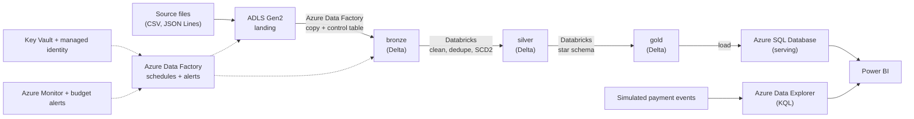

# Azure Data Platform: UAE Banking & Payments

An end-to-end Azure data engineering project on a synthetic UAE retail-banking and card-payments dataset. Raw files are ingested with **Azure Data Factory**, transformed in **Azure Databricks** (PySpark and Delta Lake) through a bronze, silver and gold design, served from **Azure SQL Database** to **Power BI**, with a real-time branch on **Azure Data Explorer (KQL)**.

> **Status: in progress.** Nothing below is claimed as working until its phase is ticked in [`docs/build-plan.md`](docs/build-plan.md). Evidence (screenshots, exported pipeline JSON, notebooks) is committed phase by phase.

## Why this project

Banking and payments are major data-engineering employers in the UAE. The dataset is built to be realistic:

- batch files, a nested JSON feed, FX rates and a payment-event stream
- customers whose segment and emirate change over time (slowly changing dimensions)
- transaction files with deliberate data-quality problems (duplicates, late arrivals, missing and negative amounts, inconsistent dates and currencies, orphan keys)

All data is **synthetic**, generated by [`scripts/generate_dataset.py`](scripts/generate_dataset.py). No real customer, card or account data is used anywhere.

## Architecture (target)



Design details and the reasons behind each choice: [`docs/architecture.md`](docs/architecture.md) and [`docs/decisions/`](docs/decisions/).

## Tech stack

| Area | Service |
|---|---|
| Storage | Azure Data Lake Storage Gen2 (hierarchical namespace) |
| Ingestion and orchestration | Azure Data Factory |
| Transformation | Azure Databricks (PySpark, Delta Lake) |
| Serving | Azure SQL Database (T-SQL star schema) |
| Real-time | Azure Data Explorer free cluster (KQL) |
| Reporting | Power BI |
| Security | Microsoft Entra ID, RBAC, managed identity, Key Vault |
| Operations | Azure Monitor, Cost Management budget alerts |
| Source control | Git and GitHub |

## Repo layout

```
docs/          architecture, setup guide, build plan, cost guardrails, skills tracker, decisions
scripts/       dataset generator (a payment-event simulator is added in Phase 6)
data/          generated files (git-ignored: regenerate with the script)
adf/           Data Factory pipelines exported from the portal (added in Phase 1)
databricks/    notebooks (added in Phase 2)
sql/           T-SQL for the serving layer (added in Phase 4)
adx/           KQL queries (added in Phase 6)
```

Folders marked "added in Phase N" are created when that phase is built, so the repo only ever contains work that exists.

## Quick start

1. Read [`docs/azure-setup.md`](docs/azure-setup.md) and create the Azure resources.
2. Generate the data (needs Python 3.9+ with `pandas` and `numpy`):

   ```
   cd scripts
   python generate_dataset.py --out ../data
   ```

3. Upload `data/raw/` to the `landing` container and follow [`docs/build-plan.md`](docs/build-plan.md).

## Build phases

| Phase | Title | Status |
|---|---|---|
| 0 | Foundations: resource group, storage, budget alert | In progress |
| 1 | Ingestion with Data Factory | Not started |
| 2 | Bronze and silver with Databricks | Not started |
| 3 | Incremental loads and SCD2 | Not started |
| 4 | Gold star schema and Azure SQL serving | Not started |
| 5 | Orchestration, security and secrets | Not started |
| 6 | Real-time branch with Azure Data Explorer | Not started |
| 7 | Monitoring, documentation and wrap-up | Not started |

Skill-by-skill progress: [`docs/skills-tracker.md`](docs/skills-tracker.md).

## Cost and safety

Built on an Azure free-trial subscription with a fixed credit that expires, so cost control is part of the project. See [`docs/cost-guardrails.md`](docs/cost-guardrails.md). Never commit secrets, tokens, keys or connection strings (the `.gitignore` blocks common patterns, but check before every push).

## Data model and data-quality problems

See [`docs/data-dictionary.md`](docs/data-dictionary.md). The transaction files contain injected problems on purpose. Find them yourself first, then compare with the answer key in `docs/dq-answer-key.json`.

## Author

Sneha Mahapadi. Senior BI analyst moving into data engineering.
