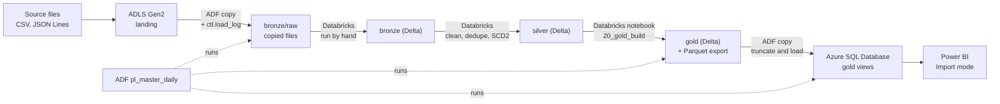

# Azure Data Platform: UAE Banking & Payments

An end-to-end Azure data engineering project on a **synthetic** UAE retail-banking and card-payments dataset. Raw files are ingested with **Azure Data Factory**, transformed in **Azure Databricks** (PySpark and Delta Lake) through a bronze, silver and gold design, served from **Azure SQL Database** and reported in **Power BI**.

> **Status (17 November 2026):** Phases 0 to 5 and 7 are done. The Azure resources ran on a free-trial subscription and were deleted on 9 and 10 November 2026, so this repo (code, exported pipelines, screenshots) is the evidence, not a live system. Phase 6 was added afterwards as a batch-loaded KQL analysis on a free Azure Data Explorer cluster, which sits outside that subscription. It is not real-time streaming.

## What was built, and what was not

| Built and run on Azure | Not built |
|---|---|
| ADLS Gen2 lake with landing, bronze, silver and gold containers | Real-time streaming into Azure Data Explorer (Phase 6 uses batch-loaded files) |
| ADF pipelines with a `month` parameter, a control table and a deliberate failure path | Key Vault (not used; see [`docs/security-notes.md`](docs/security-notes.md)) |
| Databricks notebooks: bronze, silver (cleaning, deduplication, SCD Type 2) and a gold star schema | CI/CD, infrastructure as code, private networking |
| Parent pipeline `pl_master_daily` that runs ingestion, the gold build and the SQL load | Automated bronze and silver runs (these notebooks are run by hand) |
| Azure SQL Database serving layer: tables, views, one stored procedure | Verified firing of the failure alert (see limitations) |
| Power BI report on the SQL views | |
| KQL analysis on a free Azure Data Explorer cluster (batch-loaded files, see [`adx/`](adx/)) | |

## Architecture (as built)



The reference-data copy writes to `bronze/raw/<dataset>/load_date=<date>/` (checked in the exported pipeline JSON).

`pl_master_daily` takes a `month` parameter (default `01`) and runs four steps in order: `run_reference` (reference data ingest), `run_transactions` (transactions ingest), `run_gold_build` (Databricks notebook, 30 minute timeout, no retry) and `run_load_sql` (gold to Azure SQL). The bronze and silver notebooks are **not** part of it.

How the pieces connect:

- **Lake access from Databricks:** Unity Catalog with an access connector, a storage credential and external locations for bronze, silver and gold. No storage keys in notebooks or Git.
- **ADF to Databricks:** the ADF managed identity, with Contributor on the Databricks workspace and Unity Catalog grants. No access token stored in ADF.
- **Gold build:** overwrites the Delta tables, so reruns are safe. A reconciliation cell compares silver and gold AED totals and fails the notebook if they differ.
- **SQL load:** ADF copies the exported Parquet and truncates each target table first, so reruns do not duplicate rows.

Design reasons for each choice: [`docs/architecture.md`](docs/architecture.md) and [`docs/decisions/`](docs/decisions/).

## Results

### Pipeline runs

A full run of `pl_master_daily` for month `01`, started 6 November 2026 (from the ADF Monitor screenshot, [`docs/screenshots/phase5-master-success.png`](docs/screenshots/phase5-master-success.png)):

| Step | Duration |
|---|---|
| `run_reference` | 26 s |
| `run_transactions` | 2 min 59 s |
| `run_gold_build` (Databricks notebook) | 9 min 44 s |
| `run_load_sql` | 3 min 18 s |
| **Whole pipeline** | **16 min 37 s** |

Databricks records the notebook run itself as 2 min 15 s (Jobs & Pipelines, Runs), so most of the 9 min 44 s ADF recorded for that step was time before the notebook started, most likely cluster start-up (inferred from the timestamps, not measured).

**Failure path.** For month `10`, which has no file in landing, the transactions step fails with "Source file not found in landing" (raised by a deliberate Fail activity). The gold build and SQL load never start, so no partial data reaches the serving layer. Three failed runs are visible in [`docs/screenshots/phase5-monitor-runs.png`](docs/screenshots/phase5-monitor-runs.png); the error text is in [`docs/screenshots/phase5-master-failure-error.png`](docs/screenshots/phase5-master-failure-error.png).

### Report

The Power BI report covers January to September 2026 ([`PowerBI/uae_banking_report.pdf`](PowerBI/uae_banking_report.pdf), source file alongside). It shows 130,875 successful purchases worth AED 23.56 million, plus spend by month, merchant category, top 10 merchants and merchant emirate, and decline and fraud rates by month (decline about 3.4 to 3.6 percent, fraud about 0.7 to 0.9 percent). The cards, category, merchant and emirate charts use successful purchases at known merchants. The monthly spend chart and the rates include all valid transactions, so the monthly bars add up to about 23.63 million (from the rounded chart labels), slightly more than the card total.

**Gold tables in Azure SQL** (row counts on 8 November 2026):

| Table | Rows |
|---|---|
| `gold.dim_date` | 273 |
| `gold.dim_customer` | 5,751 |
| `gold.dim_account` | 7,835 |
| `gold.dim_merchant` | 602 |
| `gold.fact_transactions` | 221,759 |

The gold notebook reconciles silver and gold AED totals before it finishes; in the 6 November run both were 55,831,458.08 (`match: True`).

The stored procedure `gold.usp_monthly_kpi` returns one row for a month with data and raises error 50001 for a month without ([`sql/gold_procedures.sql`](sql/gold_procedures.sql)). It was tested in the Azure portal query editor on 6 November 2026.

### KQL analysis (Phase 6)

The nine transaction CSVs were loaded as raw text into a free Azure Data Explorer cluster (222,642 rows), cleaned in KQL into a typed table of 221,759 rows (883 exact duplicates removed, both timestamp formats parsed, currency codes normalised, 325 missing and 217 negative amounts kept and flagged), and converted to AED with the 819 daily FX rates. Scripts: [`adx/`](adx/). What the cleaned data shows:

- Decline rates are similar across channels (3.3 to 3.9 percent).
- The fraud label is simulated. Foreign transactions are flagged about 2 to 4 times as often as domestic ones (2.57 and 3.30 percent against 0.66 and 1.42 percent), and night-time (00:00 to 04:00) roughly doubles the domestic rate. This recovers rules built into the generator, not real fraud behaviour.
- Anomaly detection on daily AED spend flagged five unusually high days (7 June, 29 July, 29 and 31 August, 20 September 2026) and no dips. No cause was investigated.
- Batch only: no streaming was built.

## The data

All data is synthetic, generated by [`scripts/generate_dataset.py`](scripts/generate_dataset.py) (seed 7, deterministic). No real customer, card or account data is used.

| Dataset | Rows |
|---|---|
| customers (initial) | 5,000 |
| customer changes (for SCD Type 2) | 750 |
| accounts | 7,834 |
| merchants (nested JSON Lines) | 600 |
| FX rates (USD, EUR, GBP to AED, daily) | 819 |
| transactions, 9 monthly CSVs (January to September 2026) | about 222,600 |

The transaction files contain injected problems on purpose: duplicates, late-arriving rows, missing and negative amounts, inconsistent currency codes, orphan merchant and account IDs, and mixed date formats. See [`docs/data-dictionary.md`](docs/data-dictionary.md). How each was found and handled is in [`docs/progress.md`](docs/progress.md).

## Tech stack

| Area | Service |
|---|---|
| Storage | Azure Data Lake Storage Gen2 (hierarchical namespace) |
| Ingestion and orchestration | Azure Data Factory |
| Transformation | Azure Databricks (PySpark, Delta Lake, Unity Catalog), single-node cluster |
| Serving | Azure SQL Database (free offer, serverless, auto-pause), T-SQL |
| Reporting | Power BI (Import mode) |
| Security | Microsoft Entra ID, RBAC, managed identity |
| Monitoring | ADF Monitor, one Azure Monitor metric alert |
| Source control | Git and GitHub |

## Repo layout

```
adf/           Data Factory pipelines, linked services (exported through ADF Git integration)
adx/           KQL scripts for the free Azure Data Explorer cluster (raw load, cleaning, FX, analysis)
databricks/    notebooks as .py source: 00_smoke_test, 01_bronze_ingest (bronze, silver, MERGE, SCD2), 20_gold_build
sql/           T-SQL for the serving layer (gold_serving.sql, gold_procedures.sql, ctl_tables.sql)
PowerBI/       report file and PDF export
docs/          architecture, decisions (ADRs), progress log, security notes, cost notes, screenshots
scripts/       dataset generator
```


## Cost

The build runs on an Azure free-trial credit of INR 19,197.88 that expires on 10 November 2026. Costs incurred, as shown on the portal's Costs tile:

| Reading | Costs incurred this month |
|---|---|
| 5 Nov, 00:16 IST | INR 131.48 |
| 5 Nov, around 12:45 IST | INR 332.67 |
| 6 Nov, 22:13 IST | INR 343.20 |
| 7 Nov, 00:03 IST | INR 343.22 |
| 8 Nov, 14:15 IST | INR 571.58 |

Caveats: the tile counts **November only**. On 8 November the subscription overview showed **INR 1,003 incurred in total**, which puts October at about INR 431 by difference. By service for 1 to 8 November (INR 571.58): Azure Databricks 438.28, virtual machines (Databricks cluster nodes) 65.28, Data Factory 63.60, virtual network 3.37, storage 0.99. The daily cost view showed no charges after 6 November, so the rise from 343.22 to 571.58 was late posting of 6 November usage, not new activity. The "Available credits" figure lagged behind and was not used. One accidental run of a notebook cell on serverless compute (4 November) was not costed separately. No charge appears for the SQL server.

The database stayed inside the free offer: on 6 November the portal showed 94,693 vCore-seconds remaining and 193 MB used of 32 GB ([`docs/decisions/ADR-003-azure-sql-serving-layer.md`](docs/decisions/ADR-003-azure-sql-serving-layer.md)). Cost rules used: [`docs/cost-guardrails.md`](docs/cost-guardrails.md).

## Security

Summary: no secrets are stored in the repo (searches for passwords, keys and tokens found only documentation text), ADF and Databricks authenticate with managed identity, and the storage account and SQL server use public endpoints (SQL with a firewall). Full table of who can access what, and the trade-offs: [`docs/security-notes.md`](docs/security-notes.md).

## Evidence

Screenshots in [`docs/screenshots/`](docs/screenshots/): resource group contents (`phase0-resource-group.png`), storage containers (`phase0-storage-containers.png`), SQL row counts (`phase4-sql-row-counts.png`), master pipeline canvas (`phase5-master-pipeline-canvas.png`), successful and failed runs (`phase5-master-success.png`, `phase5-master-failure.png`, `phase5-master-failure-error.png`, `phase5-monitor-runs.png`), the Databricks run started by ADF (`phase5-databricks-runs.png`), gold reconciliation output (`phase5-gold-reconciliation.png`), daily costs (`phase7-cost-daily.png`), the Azure SQL free-offer settings (`phase0-sql-free-offer.png`) and the Databricks cluster configuration (`phase0-databricks-cluster.png`). Phase 6 (Azure Data Explorer): the final AED conversion check (`phase6-adx-clean-check.png`), monthly card purchase value in AED (`phase6-adx-monthly-purchases-aed.png`) and the simulated fraud-flag rate by origin and time of day (`phase6-adx-fraud-origin-time.png`). The cluster address is masked in these three.

## Limitations and known gaps

1. **The master pipeline does not run bronze and silver.** Those notebooks are run by hand; `pl_master_daily` covers ingestion, the gold build and the SQL load.
2. **The failure alert was configured but never seen to fire.** An Azure Monitor metric alert on failed pipeline runs exists with an email action group. Three failed runs did not produce an alert instance or an email, and the cause was not found. Treat alerting as unverified.
3. **Limited test coverage in the master pipeline.** Month `01` (already loaded) and month `10` (missing) were run end to end. The "load" route for a new month was not exercised through the master pipeline.
4. **Control table gaps.** `rows_copied` in `ctl.load_log` is NULL, the master pipeline does not write a result row, and the table script `sql/ctl_tables.sql` was rebuilt from the database catalog after the fact (the identity seed and increment were not captured; 1,1 is assumed).
5. **No quarantine table.** Data-quality problems are flagged with `dq_` columns in silver and filtered in gold. The notebooks do not write a separate quarantine table.
6. **Security trade-offs** of a learning build: Contributor on the Databricks workspace for ADF, one database for both control and serving tables, SQL authentication enabled next to Microsoft Entra, public endpoints. Not production patterns.
7. **No Key Vault, CI/CD, infrastructure as code, private endpoints or data catalog.** Named in [`docs/architecture.md`](docs/architecture.md) as production additions, not built.
8. **No streaming.** Phase 6 is a batch-loaded KQL analysis on a free Azure Data Explorer cluster, not real-time ingestion. The free cluster has no SLA and Microsoft can change or remove it, so the scripts in `adx/` and the screenshots are the lasting record.
9. **Power BI** monthly bars and the card total differ slightly (explained in the report footnote). Whether the `.pbix` stores any credential was not checked.

## Things that went wrong, and what they taught

- **Leftover managed group after teardown.** Deleting `rg-uae-banking-dev` removed the Databricks workspace but not its managed resource group. That group held a storage account and an access connector, and its activity log showed an hourly failing `Write EventSubscription` operation. I deleted the group by hand on 10 November 2026 and confirmed that only `NetworkWatcherRG` remained.
- A trigger run uses the **published** version of a pipeline, not the saved draft. "Pipeline is not found, please publish first" means Publish was skipped.
- Debug runs do not appear in Azure Monitor alert metrics, so alert tests need triggered runs.
- The first query after the SQL database auto-pauses can fail with "not currently available". Retrying works.
- A notebook cell run on the wrong compute (serverless instead of the cluster) is easy to do. Check the compute selector before running.
- On Windows PowerShell 5.1, `-Encoding UTF8` writes a byte-order mark. Writing files with a no-BOM UTF-8 encoder avoided noisy diffs.
- ADF commits to `main` when you save, so run `git pull` before local commits.

More in [`docs/progress.md`](docs/progress.md).

## Build phases

| Phase | Title | Status |
|---|---|---|
| 0 | Foundations: resource group, storage, budget alert | Done |
| 1 | Ingestion with Data Factory | Done |
| 2 | Bronze and silver with Databricks | Done (one deviation, see `docs/progress.md`) |
| 3 | Incremental loads and SCD2 | Done (one gap, see `docs/progress.md`) |
| 4 | Gold star schema and Azure SQL serving | Done |
| 5 | Orchestration, security and secrets | Done, with the alert caveat above |
| 6 | KQL analysis on Azure Data Explorer (batch-loaded, no streaming) | Done. See [`adx/`](adx/) |
| 7 | Monitoring, documentation and wrap-up | Done. Azure resources deleted on 9 and 10 November 2026. |

Skill-by-skill evidence: [`docs/skills-tracker.md`](docs/skills-tracker.md).

## Running it yourself

1. Create the resources following [`docs/azure-setup.md`](docs/azure-setup.md).
2. Generate the data (Python 3.9+ with `pandas` and `numpy`):

   ```
   cd scripts
   python generate_dataset.py --out ../data
   ```

3. Upload `data/raw/` to the `landing` container and follow [`docs/build-plan.md`](docs/build-plan.md). Check the Credits page at the start and end of every session.

Never commit secrets, tokens, keys or connection strings.

## Author

Sneha Mahapadi. BI and analytics professional with 8+ years of experience, building hands-on Azure data engineering projects.
