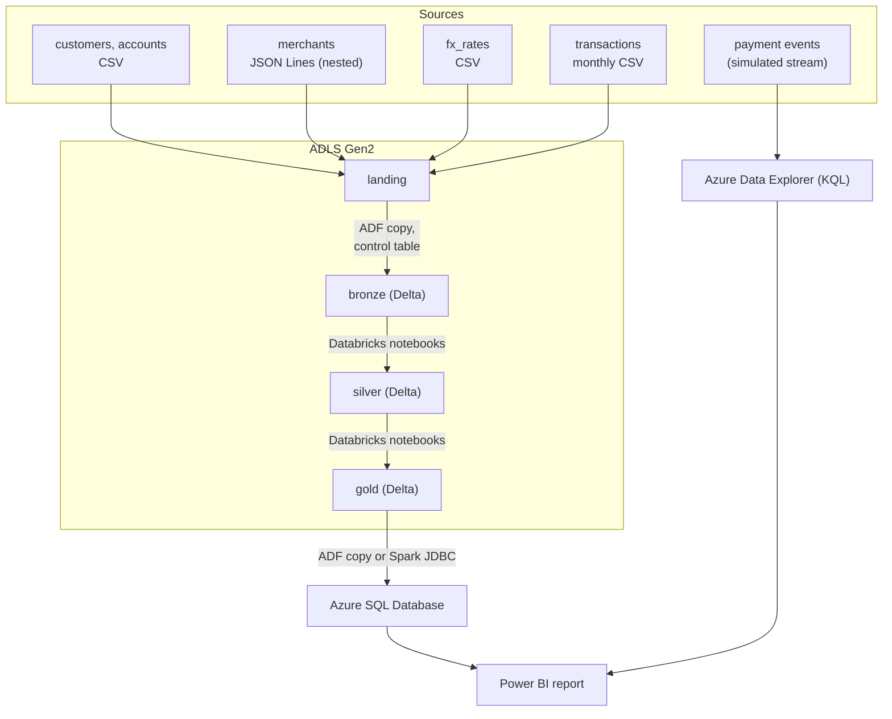

# Architecture

Status: **target design**. Each section is confirmed against the real build as its phase is completed (see [`build-plan.md`](build-plan.md)).

## Goals

1. Ingest daily-style files and a small event stream for a synthetic UAE bank.
2. Keep every raw value so any result can be reproduced from source.
3. Produce trusted, deduplicated, correctly typed tables and a star schema for reporting.
4. Run on a schedule with logging, alerts and no secrets in code.
5. Stay inside a free-trial credit budget.

## Layers

| Layer | Where | Format | Contents | Rules |
|---|---|---|---|---|
| landing | ADLS Gen2 container `landing` | CSV, JSON Lines | Files exactly as delivered, in `raw/<dataset>/...` | Never modified or deleted by pipelines |
| bronze | container `bronze` | Delta | One table per source, all columns as strings, plus `_source_file` and `_ingested_at` | No cleaning. Duplicates and bad values kept |
| silver | container `silver` | Delta | Typed, deduplicated, standardised, flattened. Customer history as SCD2 | Rejected rows go to a quarantine table with a reason |
| gold | container `gold` | Delta | Star schema: `dim_customer`, `dim_account`, `dim_merchant`, `dim_date`, `fact_transactions`, plus daily aggregates | Business-ready, stable column names |
| serving | Azure SQL Database | T-SQL tables and views | Gold tables loaded for reporting | Power BI reads only from here |

## Flow

## Orchestration

- A parent ADF pipeline runs: check for the new file, copy it, record the run in a control table, run the Databricks notebooks in order (bronze, silver, gold), load the serving tables, and send an alert on failure.
- Incremental loads use a **watermark** (last loaded month and last processed timestamp) kept in a small control table in Azure SQL Database.
- Triggers: a schedule trigger first. A storage-event trigger is a stretch goal.
- Reruns must be safe: loading the same month twice must not create duplicates (Delta `MERGE` on the business key).

## Security design

- **No secrets in code or Git.** Connection secrets go in Key Vault. Where a service supports it, use its **managed identity** with a role assignment instead of any secret.
- **Least privilege.** Data Factory's identity gets only the storage data role it needs on the lake. Personal user access is separate from service access.
- **Synthetic data only.** Fields that would be sensitive in a real bank (national ID, card number, IBAN) are deliberately not generated. The design notes where masking and column-level restriction would apply in a real deployment.
- **Network.** A trial build uses public endpoints with firewall rules limited to what is needed. Private endpoints are described as a production difference, not built.

## Monitoring and cost

- ADF pipeline run history and alerts for failures.
- Databricks job run history. Clusters are single-node with short auto-termination.
- A budget alert and a daily look at the credits page. See [`cost-guardrails.md`](cost-guardrails.md).

## What a real production build would add

Private networking, separate dev/test/prod subscriptions, infrastructure as code (Bicep or Terraform), CI/CD with approvals, data catalog and lineage (Microsoft Purview), data contracts with source teams, and a disaster-recovery plan. These are named here so reviewers can see they are understood, but they are not built in this trial project.

## Key decisions

See [`decisions/`](decisions/):

- [ADR-001](decisions/ADR-001-lake-and-medallion.md): ADLS Gen2 with a Delta medallion layout
- [ADR-002](decisions/ADR-002-adf-orchestrates-databricks-transforms.md): ADF orchestrates, Databricks transforms
- [ADR-003](decisions/ADR-003-azure-sql-serving-layer.md): Azure SQL Database as the serving layer
- [ADR-004](decisions/ADR-004-streaming-on-adx.md): streaming branch on Azure Data Explorer
